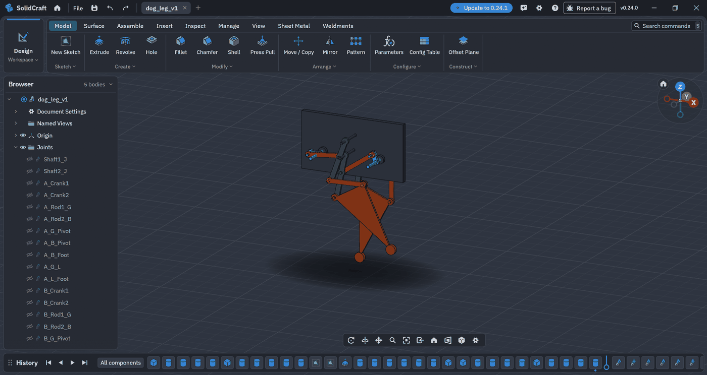
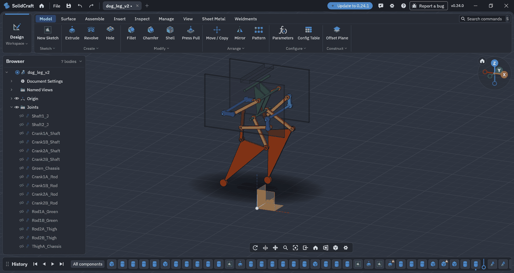
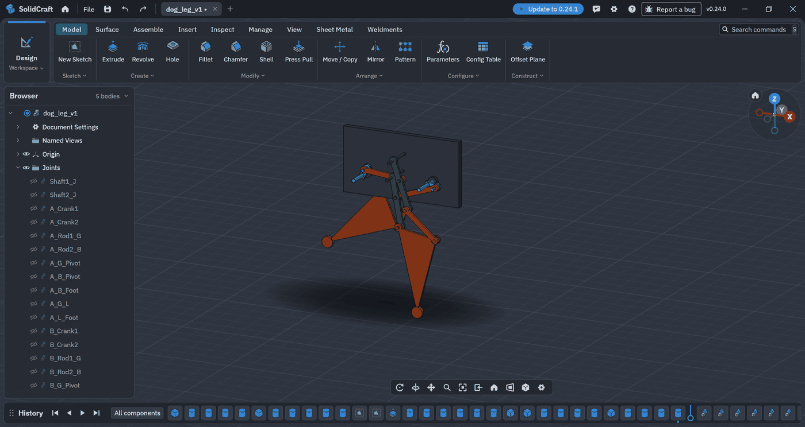
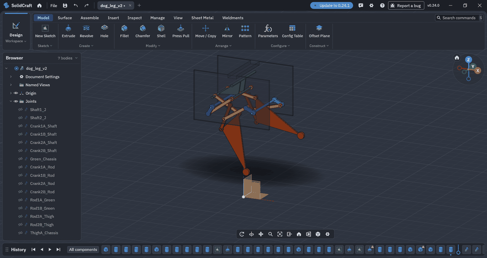

# SolidCraft-Agent-Skills

**Version 0.24 (initial release).** The version number follows the SolidCraft release these skills were written and checked against. This is an early, evolving collection, not a finished one. Expect gaps, and expect failures on complex geometry (see the lessons below).

Skills for AI agents (Claude and others that read the [Agent Skills](https://agentskills.io) format) that model in [SolidCraft](https://github.com/tangency-labs/solidcraft) through its MCP server. The repository is updated from time to time. For now the focus is on working around the limitations that come with SolidCraft still being in beta: crashes, app hangs, silently wrong booleans, fillets that fail. Almost every feature is covered by one of these skills.

Contributions are welcome. Found a failure or a workaround? [Open a "New lesson" issue](https://github.com/randomonkey05/SolidCraft-Agent-Skills/issues/new?template=new-lesson.yml), or see [CONTRIBUTING.md](CONTRIBUTING.md).

## Skills

| Skill | Loads when the agent | Origin |
|---|---|---|
| [`solidcraft-modeling`](skills/solidcraft-modeling/SKILL.md) | builds a new part (enclosure, bracket, plate, flange, ...) | SolidCraft official |
| [`solidcraft-editing`](skills/solidcraft-editing/SKILL.md) | changes, fixes or extends an existing design | SolidCraft official |
| [`solidcraft-checking`](skills/solidcraft-checking/SKILL.md) | verifies a design: parameter ranges, exact STEP comparison, regression tests | SolidCraft official |
| [`solidcraft-mechanisms`](skills/solidcraft-mechanisms/SKILL.md) | builds or animates an assembly: components, joints, motion studies | SolidCraft official |
| [`solidcraft-assemblies`](skills/solidcraft-assemblies/SKILL.md) | builds a multi-part assembly, static or moving: instances and mirrors instead of copies, layer maps, collision-free motion | this repo |
| [`solidcraft-robust-build-order`](skills/solidcraft-robust-build-order/SKILL.md) | builds any part and wants the order that fails least: booleans, fillet regimes, analytic checks, parametric generators | this repo |
| [`solidcraft-speed-modeling-lessons`](skills/solidcraft-speed-modeling-lessons/SKILL.md) | models from a drawing under time pressure, or a build crashes, hangs or returns a wrong volume | this repo |
| [`solidcraft-drawing-and-tutorial-reading`](skills/solidcraft-drawing-and-tutorial-reading/SKILL.md) | builds from a drawing, PDF, tutorial video or transcript | this repo |
| [`solidcraft-tutorial-recipes`](skills/solidcraft-tutorial-recipes/SKILL.md) | gets a task described in GUI terms and needs the matching MCP commands | this repo |
| [`solidcraft-sheet-metal`](skills/solidcraft-sheet-metal/SKILL.md) | models bent sheet-metal parts: flanges, hems, folds, flat pattern, DXF | this repo |
| [`solidcraft-sheet-metal-flatpack`](skills/solidcraft-sheet-metal-flatpack/SKILL.md) | models laser-cut flat-pack enclosures: ear tabs, bend slits, perforation, separate side plates; includes reference notes on slit design and bend formulas | this repo |
| [`solidcraft-shell-and-tangent-arcs`](skills/solidcraft-shell-and-tangent-arcs/SKILL.md) | uses `solid.shell`, or a shell fails or hangs | this repo |
| [`solidcraft-sweep-and-boolean-hangs`](skills/solidcraft-sweep-and-boolean-hangs/SKILL.md) | sweeps (twist, scale) or cuts and joins on a swept body | this repo |
| [`solidcraft-3d-print-dfm`](skills/solidcraft-3d-print-dfm/SKILL.md) | designs a model for FDM 3D printing | this repo |
| [`solidcraft-dfm-review`](skills/solidcraft-dfm-review/SKILL.md) | reviews a sheet-metal or CNC part for manufacturability, or checks a flat-pattern DXF against SendCutSend's per-SKU limits before ordering | adapted from text-to-cad (MIT) |
| [`solidcraft-step-parts`](skills/solidcraft-step-parts/SKILL.md) | needs real screws, bearings, standoffs or motors in an assembly: step.parts search, checksum, `file.insert_step` | adapted from text-to-cad (MIT) |
| [`solidcraft-engineering-drawing`](skills/solidcraft-engineering-drawing/SKILL.md) | is asked for an engineering drawing or dimensioned views of a part | adapted from text-to-cad (MIT) |
| [`solidcraft-requirements-and-sanity`](skills/solidcraft-requirements-and-sanity/SKILL.md) | designs from a vague brief with no drawing: asks the blocking questions in one round before building, then checks walls, hole edges, clearances and process | adapted from mechanical-cad-skills (MIT) |
| [`solidcraft-delivery-gate`](skills/solidcraft-delivery-gate/SKILL.md) | is about to call a model, export or drawing finished: fresh, non-empty files that match the last measure, verified vs unverified claims | adapted from mechanical-cad-skills (MIT) |
| [`solidcraft-hole-fastener-rules`](skills/solidcraft-hole-fastener-rules/SKILL.md) | needs screw holes, tapped holes, counterbores, pockets or spur gears: clearance and tap-drill sizes, edge and web minimums by process, gear formulas (reference data) | adapted from solidworks-automation-skill (MIT) |

The four official skills are copied **unchanged** from SolidCraft 0.24.0 (see [NOTICE](NOTICE)). Three more are adapted from [earthtojake/text-to-cad](https://github.com/earthtojake/text-to-cad) (MIT, see [NOTICE](NOTICE)), and `solidcraft-3d-print-dfm` gained a cross-check against the published limits in the same project. Three more (`solidcraft-requirements-and-sanity`, `solidcraft-delivery-gate`, `solidcraft-hole-fastener-rules`) take ideas from two other MIT projects, rewritten for SolidCraft (see [NOTICE](NOTICE)). The other ten are original to this repository (counting `solidcraft-3d-print-dfm`).

## Example: a dog-leg mechanism, before and after

A walking-leg mechanism driven by two shafts, modelled twice with the same agent. **v1** was built before the `solidcraft-assemblies` skill existed. **v2** was rebuilt from scratch following that skill. Each version is shown at home and with the crank turned to 120 degrees.

| | v1 (before the skill) | v2 (with the skill) |
|---|---|---|
| Home |  |  |
| Crank at 120 degrees |  |  |

| Counted from the design files | v1 | v2 |
|---|---|---|
| Distinct bodies (part types) | 5 | 7 |
| Instances placed | 15 | 18 |
| Joints | 20 revolute | 19 revolute, 4 rigid |

These counts are not a score. The skill does not aim for the fewest part types. It aims for one body per part type with every identical or mirrored part placed as an instance, a layer map along the rotation axis so moving links do not sweep through each other, and a check through the full range of motion before delivering.

## More examples

- [CD-ROM player flat-pack enclosure, two versions](examples/cdrom-player-flatpack/README.md): large folded panels and round ear tabs at the screw locations, with 3MF and SolidCraft design files.
- [Two sheet-metal tutorials rebuilt](examples/sheet-metal-tutorials/README.md): a phone stand with cuts made in the flat state, and a block converted to sheet metal, with 3MF, design, DXF and bend-table files.

## Install

Claude Code, for all projects:

```sh
git clone --depth 1 https://github.com/randomonkey05/SolidCraft-Agent-Skills
cp -r SolidCraft-Agent-Skills/skills/solidcraft-* ~/.claude/skills/
```

Windows (PowerShell):

```powershell
git clone --depth 1 https://github.com/randomonkey05/SolidCraft-Agent-Skills
Copy-Item -Recurse SolidCraft-Agent-Skills\skills\solidcraft-* $HOME\.claude\skills\
```

- **One project only:** copy the folders into that project's `.claude/skills/` instead.
- **Other agents:** copy the folders into the skills directory your agent's documentation names.
- **Updating:** pull and copy the folders again.

## Known limits

- These skills reduce the failure rate on complex geometry, they do not remove it. Booleans on swept or spherical bodies, shells on thin walls and fillets near knife edges can still hang the app. Save checkpoints.
- Values marked (UNVERIFIED), mostly in the 3D-printing skill, are working values that no real print has confirmed yet.
- Written for SolidCraft 0.24. When a command or behaviour changes, the affected skill needs updating.

## Licence

Apache License 2.0, see [LICENSE](LICENSE). The four official skills come from SolidCraft, which is dual-licensed MIT or Apache-2.0, and are used here under Apache-2.0. Details in [NOTICE](NOTICE).

The repository contains no drawings, videos or solution files from public tutorials or speed-modeling challenges, only lessons learned from them.
