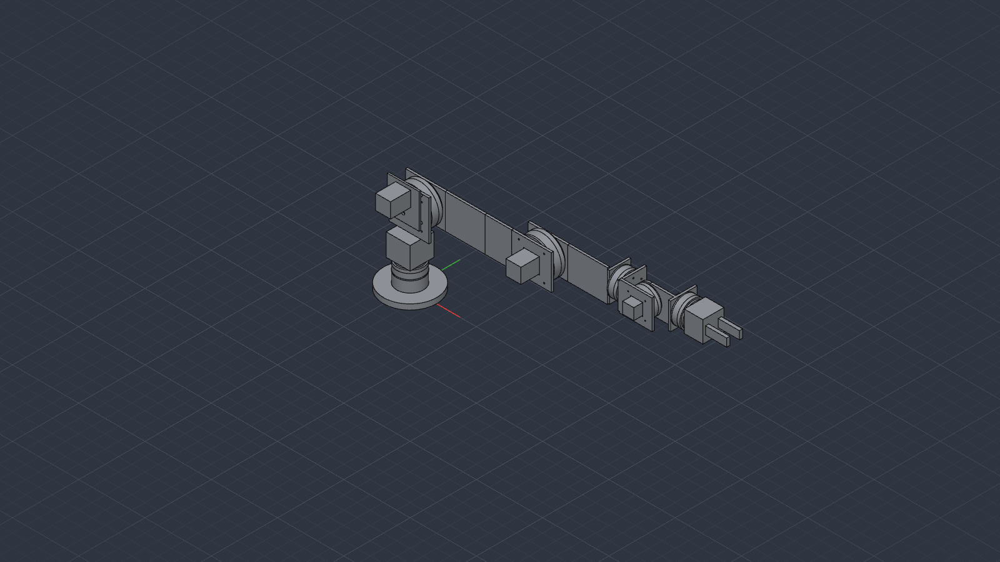
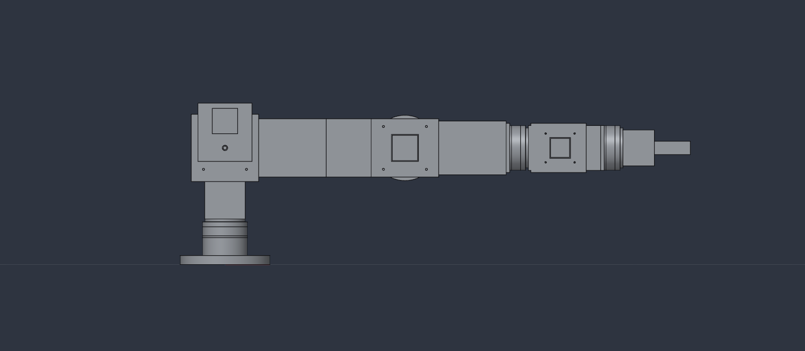
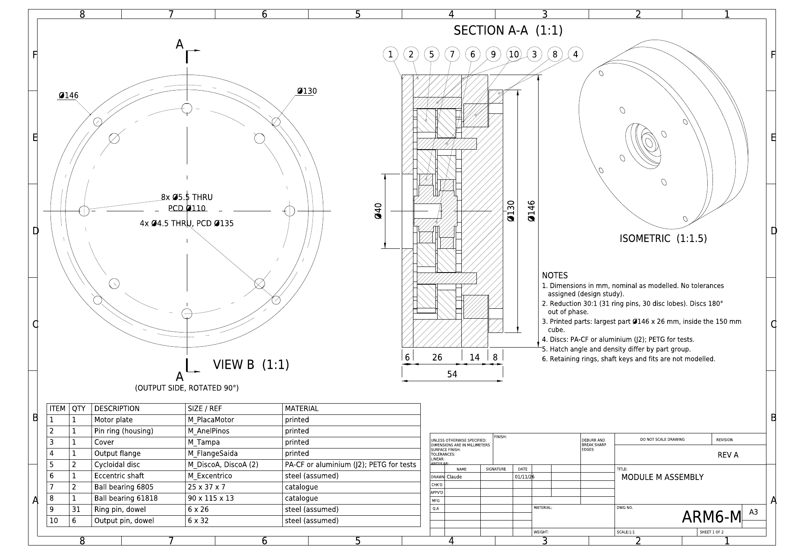
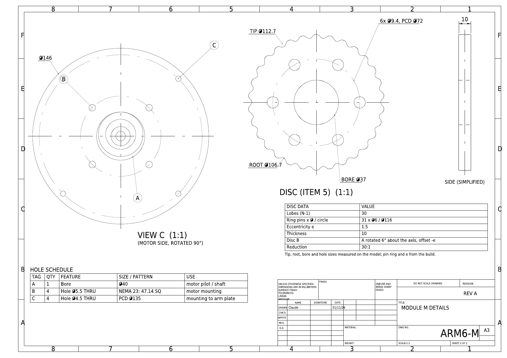
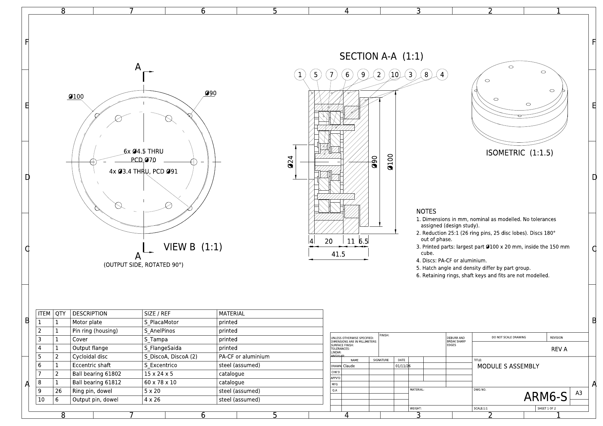
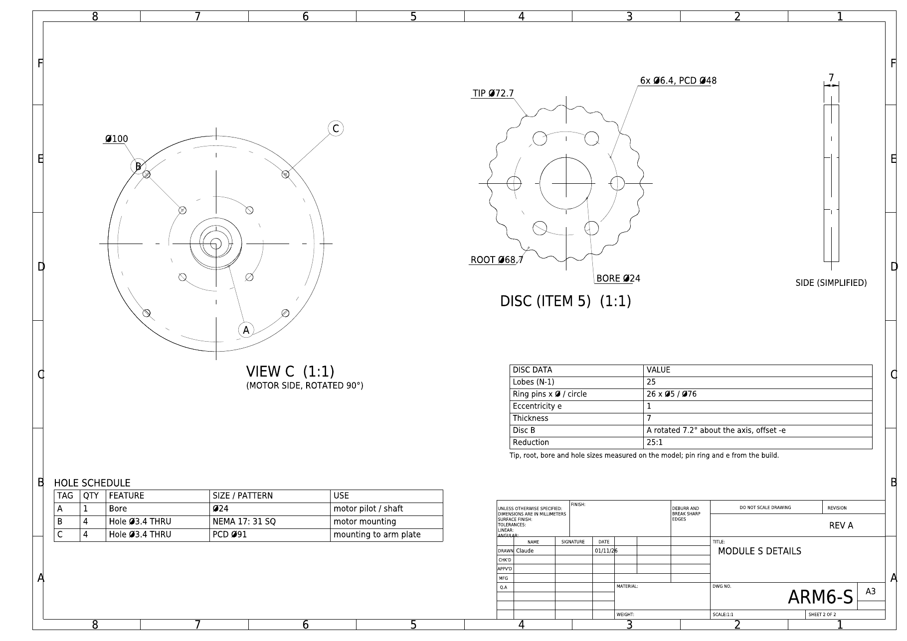

# Example: a 6-DOF stepper robot arm from one prompt

A 1 m reach, 0.5 kg payload, six-joint robot arm with an open/close gripper, designed in SolidCraft by an agent in **one session** that started with a plain-language brief and only the skills in this repository. It is a worked example of what the skills make possible when the brief is vague, and of where they do and do not catch problems.

It is a **design study, not a validated robot**. Nothing here has been printed, assembled or load-tested. Torques use estimated masses and a static model (see [What is and is not verified](#what-is-and-is-not-verified)).

[`robot-arm-6dof-animation.mp4`](robot-arm-6dof-animation.mp4) shows the motion study (5.6 s). J1 swings about 50 degrees each way, J2 and J3 fold the arm, J4 and J6 turn a full revolution, J5 swings 60 degrees each way. The gripper is not animated.

## The prompt that started the session

The session began by invoking `solidcraft-requirements-and-sanity` with this brief (translated from the original Portuguese; the payload was first 1 kg and was lowered to 0.5 kg during the session, after the torque check below, and the prompt here shows the final value):

> /solidcraft-requirements-and-sanity I want you to make a robot arm with 6 degrees of freedom. The robot must have a reach of 1 metre and hold 0.5 kg at its position furthest from the base. At the tip there is a gripper that only needs open and close positions. All joints must be rotary with stepper motors. Assume 3D printing in a maximum 15 cm cube for all parts that are not catalogue parts.

There was no drawing, sketch or reference design. The agent worked from this text and from the skills.

## Files

| File | What it is |
|---|---|
| [`robot-arm-6dof-v3.json`](robot-arm-6dof-v3.json) | Editable SolidCraft design: components, link occurrences, six revolute joints, the `Demo` motion study |
| [`robot-arm-6dof-v3-assembly.step`](robot-arm-6dof-v3-assembly.step) | Whole assembly as STEP |
| [`printed-structure-v3.3mf`](printed-structure-v3.3mf) | Printed structure parts with the bolt holes (base, tower, arm and forearm plates, wrist brackets, gripper body and fingers, J2 belt plate and spacers) |
| [`printed-module-S.3mf`](printed-module-S.3mf), [`printed-module-M.3mf`](printed-module-M.3mf) | Printed parts of the two cycloidal modules (small and medium) |
| [`robot-arm-6dof-animation.mp4`](robot-arm-6dof-animation.mp4) | The motion study |
| [`drawings/`](drawings) | A3 drawings of modules M and S (2 sheets each) as PDF, DXF and PNG |

Part and component names in the design are in Portuguese (`Braco` arm, `Ante` forearm, `Garra` gripper, `Elo` link, `Estrutura` structure, `Modulo` module, `Placa` plate, `Suporte` bracket, `Correia` belt, `Pedestal`, `Torre` tower).

## Engineering drawings of the two modules

After the model was finished the agent produced A3 drawings of both cycloidal modules with the `solidcraft-engineering-drawing` skill: module M (J2/J3, 146 mm) and module S (J1/J4/J5/J6, 100 mm), two sheets each. They are in [`drawings/`](drawings) as PDF, DXF and PNG.

Sheet 1 is the assembly: section A-A with hatching by part group, the output-side view, an isometric, length and diameter dimensions, numbered balloons tied to a 10-item bill of materials (printed parts, discs, eccentric shaft, catalogue bearings, ring pins, output pins) and notes. Sheet 2 holds the motor-side view, a hole schedule (bore, motor pattern, mounting pattern), the cycloidal disc drawn alone and a table of disc data (lobes, ring pins, eccentricity, thickness, phase of the second disc, ratio).

How the drawings were made, and the engineering judgement behind them:

- **Numbers come from the model, not from memory.** Z levels, diameters, hole sizes and pitch circles, and the disc tip, root and bore were read with `measure` and `model.faces`. The ring-pin count and eccentricity come from the build parameters and are labelled as such on the sheet.
- **Real section views.** SolidCraft's DXF export of a view carries visible lines only, with no sections or hatching. Each body was exported alone in the cut view, the lines were turned into closed polygons (coordinates rounded to 3 decimals so loops close), matched against the cut-plane faces from `model.faces`, and hatched in the DXF. The hatch angle and density differ by group: housing, discs, catalogue parts.
- **Standard sheet.** The skill's A3 template (frame, zone letters, title block) with the usual conventions: balloons in one sorted row, dimensions outside the views, a note that no tolerances are assigned.
- **The sheet is checked by looking at it.** Every sheet was rendered to PNG and re-read. Overlaps found that way (balloons against the isometric, the notes against the section, the disc running off the sheet) were fixed by moving views and changing scales.

Limits, stated on the sheets and repeated here: no tolerances or fits, retaining rings and keys are not modelled, the materials of the eccentric shaft and pins are assumed (steel), the section plane passes through pins at y=0 so they appear cut, the disc side view is simplified, the module M disc outline was mirrored from a half-cut body, and the module S housing hole circle (91 mm) was read from the exported DXF. Only the dimensions used on the sheets were checked against the model, not the whole drawing.

## How it was built

1. **Clarify first** (`solidcraft-requirements-and-sanity`). One round of questions before any modelling: motor size, scope of the first delivery, gripper actuation. Answers: NEMA 17 with printed cycloidal reducers, skeleton plus torque table before detail, catalogue servo (MG996R class) for the gripper.
2. **Sanity table before geometry.** A static torque estimate (arm horizontal, factor of safety 1.5, 60 % of motor holding torque usable, 70 % efficiency) showed that NEMA 17 plus a printed cycloidal cannot hold 1 kg at 1 m on the shoulder and elbow. The user lowered the payload to 0.5 kg and chose **NEMA 23 at the shoulder (J2) and elbow (J3)**, NEMA 17 with cycloidal reduction on J1, J4, J5 and J6.
3. **Kinematic skeleton** with the six axes and link lengths, checked for the 1 m reach before any parts existed.
4. **Two parametric cycloidal modules.** Disc profile from the epitrochoid equations, sampled as a periodic spline. Two discs 180 degrees out of phase, ring pins, eccentric shaft, bearings, output pins and housing, all inside the 150 mm cube.
   - Small module (J1, J4, J5, J6): 26 ring pins, 25 lobes, ratio 25:1, housing 100 mm diameter.
   - Medium module (J2, J3): 31 ring pins, 30 lobes, ratio 30:1, housing 146 mm diameter.
5. **Assembly structure.** Each module is one component placed as instances. Each link is its own component, the motors are separate components so the shoulder motor could sit at a different offset, and every link is its own component so the joints can be placed between them.
6. **Torque re-check with module masses.** The factor of safety at the shoulder fell short, so a 2.5:1 GT2 belt stage was added at the shoulder input (75:1 total), with PA-CF or aluminium discs instead of PETG.
7. **Bolt holes at every interface:** flange and housing patterns on both medium modules, brackets, gripper body, pedestal, tower and the shoulder belt plate, with clearance sizes for M3, M4 and M5.
8. **Joints and motion study.** Six revolute joints on the real axes and a 160-step study.
9. **Interference checks and fixes**, then the animation and the final exports.
10. **Drawings of the two modules** (assembly with section and bill of materials, details with hole schedule and disc), see above.

The session had the whole skill set of this repository available (including `solidcraft-assemblies`, `solidcraft-hole-fastener-rules` and `solidcraft-delivery-gate`); `solidcraft-requirements-and-sanity` is the one invoked explicitly by the prompt.

## What went wrong and what it taught

- **A copy of a module component failed** ("geometry verification exceeds copy work limit") and rolled back. Fix: keep motors in their own components and instance them, offsetting one instance.
- **`occurrence.move` composes with the existing transform.** Moves on copies landed in the wrong place until corrective relative moves were computed from the returned matrices.
- **`conflicts: []` from `joint.drive` is not evidence.** It only reports conflicts when contact sets are enabled. Static `inspect.interference` at several poses and the study played through `motion.play` were used instead.
- **A real collision was found only because of that check:** the J5 bracket and the J6 bracket met whenever J5 was not zero. Rounding the rear end of the J6 plate around the J5 axis fixed it, and J5 at plus and minus 60 degrees was clean afterwards.
- **Whole-assembly interference timed out** at 60 s, and `motion.interference` fails with this many bodies. The check was restricted to the structure bodies.

## What is and is not verified

Using the labels from `solidcraft-delivery-gate` (Verified, Inferred, Unverified).

**Verified** (measured on the final design):
- The structure bodies do not interfere at the sampled poses (study steps 0, 30, 70, 80, 100, 110 and the home pose) after the J5/J6 bracket fix.
- The 3MF and STEP files were exported from the saved v3 design.

**Inferred** (from build parameters, not re-measured):
- Reach of about 1034 mm from the base axis to the gripper fingertips, from the link coordinates.
- Reduction ratios (25:1, 30:1, 75:1 with the belt) from lobe and pin counts.
- That every printed part fits the 150 mm cube.

**Unverified:**
- Torques. Masses are estimates and the model is static. The factor of safety is about 1.33 at J2, 1.47 at J3 and 1.38 at J5 with the conservative derating above. That is a prototype margin and has to be measured, for example with a spring or gas-spring counterbalance at the shoulder as a next step.
- Cycloidal tooth profile, clearances (the pins use a 0.15 mm print clearance) and backlash, which have never been printed.
- Disc material. PETG discs will not survive the shoulder load, PA-CF or aluminium is the working assumption.
- Retaining rings, shaft bores in the pulleys, wiring and the belt itself are not modelled. The input shaft overlaps the 60-tooth pulley because its bore is not modelled.
- The MG996R servo is not modelled, the gripper body is a solid block, and the gripper does not move in the animation.
- Modules and motors were **not** checked against the structure for interference, and in the animation the module flanges stay with the housing instead of rotating with the output.

## Why this example is here

The brief was short and had no reference. The things that made the result usable were the process the skills impose: questions before building, a sanity table that exposed the infeasible payload before any geometry, one component per link and checks that did not trust a silent `conflicts: []`. The human decisions (payload, motor choice, belt stage) were taken from that table, not guessed. The model still needs real engineering review before anything is printed.
